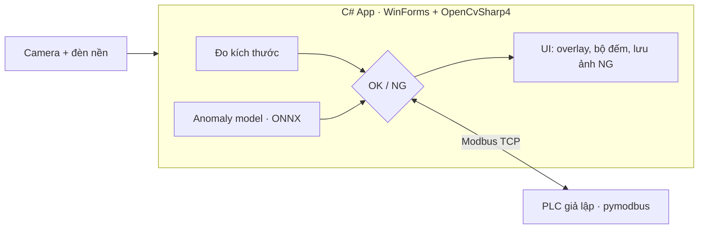

# WasherVision — Automated Dimensional & Defect Inspection System

Trạm kiểm tra vòng đệm (washer) tự động: camera chụp → đo kích thước + phát hiện lỗi → OK/NG → gửi kết quả sang PLC (Modbus TCP).

> Trạng thái: đang phát triển.

## Cấu trúc

| Thư mục | Nội dung |
|---|---|
| `python/` | Hiệu chuẩn camera, prototype đo kích thước, train anomaly, export ONNX |
| `csharp/` | Ứng dụng WinForms chạy thực tế |
| `plc_sim/` | Server Modbus TCP giả lập PLC |
| `config/` | `tolerance.json`, `camera.json`, `calib.yml` |
| `data/` | Ảnh chụp: `raw/`, `ok/`, `ng/` |
| `docs/` | Tài liệu dự án |

## Tài liệu

| File | Trả lời |
|---|---|
| [docs/DECISIONS.md](docs/DECISIONS.md) | Vì sao chọn cách này |
| [docs/RESULTS.md](docs/RESULTS.md) | Chính xác và nhanh tới đâu |
| [docs/SETUP.md](docs/SETUP.md) | Phần cứng và cài môi trường |

## Kết quả

Chưa đo. Xem [docs/RESULTS.md](docs/RESULTS.md).
